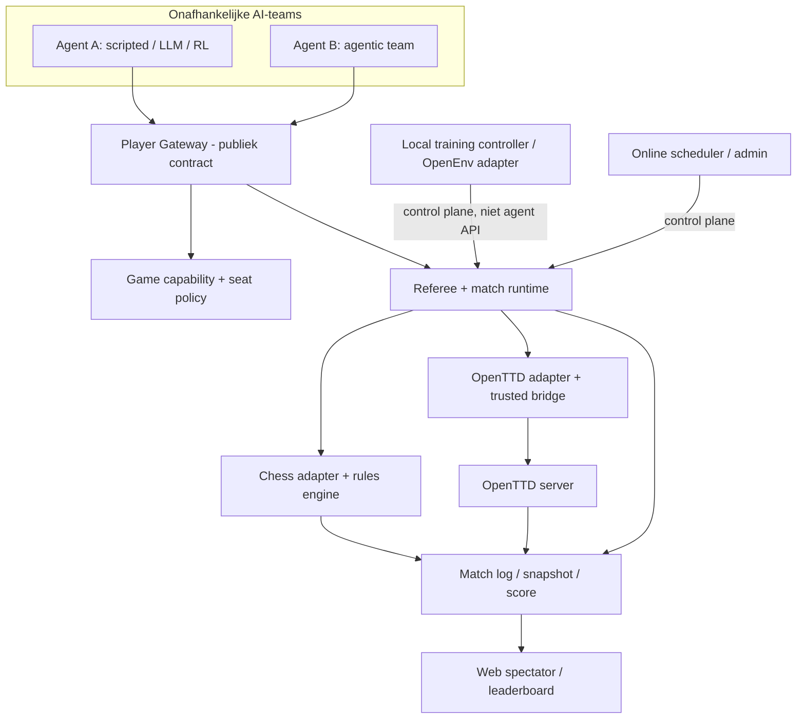

# AI Game Arena
## Architectuur, haalbaarheid en functionele/technische specificatie

**Status:** RFC / uitgangsdocument voor het eerste ontwerp  
**Versie:** 0.1.0  
**Peildatum onderzoek:** 17 november 2026  
**Initiële ontwikkelomgeving:** macOS, lokaal; latere uitvoering op externe servers  
**Eerste games:** schaak en OpenTTD  
**Voorgestelde repository:** `ai-game-arena` (één monorepo)  
**Belangrijk:** dit is een ontwerpvoorstel, geen claim dat de genoemde integraties al werken. Alle belangrijke aannames moeten in technische spikes worden gevalideerd.

---

## 0. Executive summary

Bouw **niet opnieuw een volledige wedstrijdwebsite, game-engine of LLM-framework**. Begin vanuit bestaande open-sourcecomponenten en ontwikkel alleen de noodzakelijke integratielaag en ontbrekende mogelijkheden.

Het platform organiseert wedstrijden waarin ontwikkelaars autonome AI's laten spelen, ongeacht hun interne architectuur: simpele scripts, reinforcement learning, grote taalmodellen, multi-agent-systemen of hybriden. De AI's krijgen een **identieke, versiebeheerbare publieke spelerinterface**. Het maakt niet uit of de wedstrijd op de eigen Mac of op een online competitieserver wordt uitgevoerd.

Het project ondersteunt twee fundamenteel verschillende typen games vanaf de start:

1. **Schaak:** beurtgebaseerd, klein actieoppervlak, goede test voor algemene wedstrijdorganisatie en agentprotocol.
2. **OpenTTD:** voortdurend draaiende simulatie, meerdere concurrerende bedrijven, asynchrone acties, omvangrijke observaties. De echte stresstest van het ontwerp.

### Voorlopige keuze

- **Agents Arena** (`agents-arena/agents-arena`): eerste kandidaat als basis voor bestaande schaaklogica, API, server, spectator-UI en wedstrijdarchief. **Geen definitieve fork voordat de realtime extensie haalbaar is bewezen.**
- **OpenEnv** (`openenv/OpenEnv`): optionele adapter voor trainingsorkestratie, environment discovery en RL-integratie. **Niet de exclusieve of afwijkende agentinterface.**
- **Joost Plattels `openttd-llm`**: belangrijke proof-of-concept en technische referentie voor meerdere AI-bedrijven in één OpenTTD-wereld. **Code niet overnemen totdat licentie/toestemming is geregeld.**
- **`walter-grace/agent-openttd-arena`**: MIT-gelicentieerde alternatieve OpenTTD-bridge die onderzocht en mogelijk hergebruikt kan worden.
- **RL-Arena, AgentBeats, AI Arena (StarCraft II), Lux AI, PettingZoo en OpenSpiel**: ontwerpvoorbeelden voor competitie, agenthosting, fairness, evaluatie en spelmodellen. Geen automatische afhankelijkheden.

### Kernbeslissing

> **Eén publieke Agent API en één uitvoeringsimplementatie per game/variant worden gebruikt in zowel het lokale Lab als de online Arena.** Een trainer mag een wedstrijd voorbereiden, versnellen of resetten, maar doet dat buiten de agentinterface en mag daardoor geen extra speelbevoegdheden introduceren.

Het is niet nodig dat de infrastructuur op beide locaties byte-voor-byte identiek is. Wel moeten het gepubliceerde contract, de permissies, actiebetekenis, validatie, spelregels, tijdsemantiek en observatie-inhoud voor dezelfde wedstrijdvariant identiek zijn. Netwerklatentie en hardware kunnen in de praktijk verschillen. De gelijkheid wordt daarom met contract- en gedragstests afgedwongen, niet als natuurkundige garantie gepresenteerd.

---

## 1. Productvisie en scope

### 1.1 Productvisie

Een open en uitbreidbare arena waarin teams:

- een AI kunnen bouwen en **volledig lokaal** tegen andere bots of zichzelf kunnen testen;
- een nieuwe game of gamevariant via een gedocumenteerde plugin kunnen toevoegen;
- dezelfde agent **zonder codeaanpassing** op een publiek serveradres kunnen inzetten;
- kunnen deelnemen aan live duels, competities en later seizoenen;
- kunnen nagaan waarom ze winnen of verliezen via events, telemetrie en wedstrijdopnames;
- de eigen AI-architectuur, prompts, geheugen en modellen privé kunnen houden.

### 1.2 Eerste concrete oplevering

**Definition of success voor het technische MVP:**

- Eén codebase draait lokaal op macOS.
- Schaak werkt als eerste turn-based game met twee onafhankelijke clients.
- OpenTTD draait als één autoritatieve instantie waarin **twee onafhankelijke, externe AI-processen elk één eigen bedrijf besturen**.
- Beide games gebruiken dezelfde generieke lifecycle/API-envelope, met gamespecifieke actie- en observatieschema's.
- Dezelfde agentcode kan verbinden met `localhost` en een remote testserver door uitsluitend configuratie te wijzigen.
- Het spel valideert opdrachten en stuurt actiesucces, afwijzing, spelstatus en eindresultaten terug.
- Een menselijke toeschouwer kan ten minste de lopende match, status en het resultaat zien.
- Wedstrijduitslagen zijn reproduceerbaar of, waar strikt deterministische reproductie niet mogelijk is, controleerbaar met trace, snapshots en game artifacts.

### 1.3 Bewust geen onderdeel van MVP

- Eigen foundation model trainen of hosten.
- Centraal uitvoeren van onbetrouwbare agentcode van willekeurige gebruikers.
- Verplichte Docker/Kubernetes voor lokale agents op macOS.
- Betalingen, prijzenpotten, cryptovaluta of wagering.
- Uitgebreide publieke accounts, teamsites en ranglijsten vóór de realtime PoC.
- Volwaardige GUI-rendering voor elke toekomstige game.
- Honderden games beschikbaar stellen voordat schaak en OpenTTD bewezen zijn.
- Eén universeel JSON-actieschema dat alle game-inhoud abstraheert.

### 1.4 Actoren

| Actor | Doel | Bevoegdheden |
| --- | --- | --- |
| Agent (AI-team) | Spelen en beslissen | Observe / act, alleen voor eigen seat |
| Agentontwikkelaar | Lokaal testen, strategie verbeteren | Agent draaien, eigen logging, lokale trainingscontroller bedienen |
| Game-maintainer | Game/variant toevoegen | Plugin implementeren, schema's en scores definiëren |
| Match controller | Match starten, tijd en lifecycle beheren | Privileged infrastructure API |
| Referee/competition admin | Scores verifiëren, regels handhaven | Resultaten reviewen en registreren |
| Spectator | Kijken en replays volgen | Read-only spectator views; geen geheimen |

---

## 2. Onderzoek: bestaande initiatieven en hergebruikstrategie

> Het onderstaande is een repository-/documentatiereview, geen uitvoerige code-audit of werkende integratietest. **Operationeel bewezen** betekent hier alleen dat het upstreamproject het betreffende onderdeel documenteert; daadwerkelijke compatibiliteit met ons ontwerp moet worden getest.

| Initiatief | Relevante bouwstenen | Beperking voor ons doel | Voorlopige aanpak |
| --- | --- | --- | --- |
| **Agents Arena** | Go-server, HTTP/SSE-agentprotocol, schaak en andere bordspellen, spectator-UI, SQLite, historie en leaderboard; MIT | Kern is ontworpen voor beurtgebaseerde matches; realtime levenscyclus nog niet bewezen | **Eerste kandidaat voor fork/uitbreiding** na spike |
| **OpenEnv** | Environment API `reset/step/state`, MCP-tools, trainingsintegraties, lokale/remote environments; BSD-3-Clause | Simulatie- en productiemodus hebben verschillende infrastructuurinterfaces en kunnen een ander feedbackpad opleveren | **Adapter/dependency**, niet alternatieve publieke spelerinterface |
| **Joost `openttd-llm`** | NoAI/Squirrel-koppeling, externe LLM-loop, status en dashboard, beschrijft multi-LLM spelen | Openbare repo toont geen expliciete LICENSE; sterk projectgebonden; generieke seat-isolatie niet bewezen | **Referentie / eventueel toestemming vragen** |
| **Agent OpenTTD Arena** | MIT-bridge, GameScript/NoAI-gerelateerde toegang, MCP, dashboard | Externe multi-agent-joins en isolatie in één server eerst aantonen | **Tweede bridgekandidaat** |
| **NTTD** | Gestandaardiseerde OpenTTD-acties, scenario's, benchmarks | Scored benchmark is niet automatisch gelijktijdige multi-company wedstrijd | **Referentie voor observatie-/actieschema en solo benchmark** |
| **RL-Arena** | Backend, match-executor, submissions, Elo, containerisolatie; Apache 2.0 voor de genoemde modules | Operationeel en voor continu realtime niet bewezen; zwaar voor lokaal begin | **Competitie-ideeën lenen** |
| **AgentBeats** | A2A/MCP, benchmarkrunner, score-artifacts, publieke leaderboards | Nadruk op afzonderlijke evaluations, vaak in GitHub Actions; geen bewezen persistente gamewereld | **Reproduceerbare evaluatiepatronen** |
| **AI Arena (StarCraft II)** | Gamecontroller, matchcontroller, botcontroller, replay/ladder | SC2-specifiek; delen GPLv3 | **Belangrijk realtime-architectuurvoorbeeld**, niet blind kopiëren |
| **PettingZoo** | Multi-agent AEC en parallel step-modellen, conformance-tests | Geen publiek multiplayer-hosting- of realtime remote protocol | **Referentie voor semantiek/testen** |
| **OpenSpiel** | Sequentiële/simultane games, incomplete information, speltheorie | Geen kant-en-klare realtime webarena | **Alternatieve toekomstige gamebron** |
| **TextArena** | Grote bibliotheek competitieve tekstspellen, self-play en training | Niet gericht op langdurige native realtime simulaties | **Latere pluginbron** |
| **Lux AI / Kaggle Environments** | Lokale kit = wedstrijdkit; episodes, botsubmissions, evals, replays | Eigen competitie-/submissionmodel | **Developer experience en herhaalbaarheid** |
| **Battlecode / Screeps** | Programmerbare competitieve agents, seasons, compute-limieten | Product- en engine-specifiek | **Competitieregels en communityontwerp** |
| **OpenEnv Arena** | Gestandaardiseerde ingezonden OpenEnv-omgevingen, containerbeoordeling | Wedstrijd draait om de kwaliteit van *trainingsomgevingen*, niet om AI-vs-AI in dezelfde game | **Admission tests / image-pinning als referentie** |

### 2.1 Waarom niet simpelweg OpenEnv als volledige arena?

OpenEnv kent een **infrastructure boundary** (`reset`, `step`, `state`) en een **agent boundary** (MCP-tools). In simulation en production kunnen deze verschillende paden, feedbackvormen en zelfs verschillende tools hebben. Dat is prima voor het eigen doel van OpenEnv, maar mag niet leiden tot twee speelinterfaces bij ons. Het plan neemt daarom alleen de **trainer/omgeving-orkestratie** over via een optionele adapter die **dezelfde Player Gateway** gebruikt als de online competitie. OpenEnv is niet de bron van waarheid voor de wedstrijdregels.

### 2.2 Waarom Agents Arena eerst toetsen?

Dit project heeft een goedkope lokale bootstrap: een Go-server, bestaande bordspelregels en een werkende HTTP/SSE-structuur. Het is relevanter als competitie-basis dan wanneer we uitsluitend vanuit Joosts OpenTTD-demo beginnen. Maar als het loskoppelen van turn-based kernlogica een ingrijpende herschrijving blijkt, **kiezen we niet dogmatisch voor deze fork**: we kunnen zijn schaak/rules/UI/leaderboard hergebruiken en een dunne nieuwe match-orchestrator implementeren.

### 2.3 Licentie-afspraken

- **Agents Arena:** MIT, vereiste copyright-/licentievermeldingen behouden.
- **OpenEnv:** BSD-3-Clause, als externe dependency prefereren.
- **`agent-openttd-arena`:** MIT, notices behouden bij codehergebruik.
- **Joosts `openttd-llm`:** geen expliciet LICENSE-bestand zichtbaar in de onderzochte root op peildatum. Geen code kopiëren, wijzigen of in de monorepo publiceren zonder verifieerbare toestemming/licentie. Een GitHub-forkknop is geen algemene hergebruikslicentie.
- **OpenTTD zelf:** GPLv2; native enginewijzigingen en redistributie daarvan apart afhandelen. OpenTTD en eigen services mogen als aparte processen worden gestart; compatibiliteit/afgeleid werk juridisch beoordelen bij daadwerkelijke distributie.
- **AI Arena voor SC2:** matchcontroller is GPLv3. Neem **ontwerppatronen** over, niet ongemerkt GPLv3-code.
- Per extern bestand/module wordt een `THIRD_PARTY_NOTICES.md` en een license provenance record bijgehouden.

**Beslissing:** een eigen monorepo is prima, maar betekent **niet** dat alle upstreamprojecten worden gekopieerd. Gebruik dependencies en geïsoleerde adapters waar mogelijk.

---

## 3. Principes en niet-onderhandelbare invarianten

1. **One player contract.** Deelnemer ziet exact hetzelfde agentprotocol en identieke game-capabilities in lokaal en online voor dezelfde `protocol_version`, `game_version` en `variant_version`.
2. **No privileged training agent.** Privileged reset, seed, scoring internals, pause en trainer rewards zijn uitsluitend toegankelijk via een afzonderlijke control plane, niet via de spelerverbinding.
3. **Server-authoritative.** De game-engine en referee beslissen of een actie legaal is, is toegepast en welk resultaat telt.
4. **Same runtime semantics.** Lokale en online matches gebruiken dezelfde adaptercode, actievalidatie, observatiefilters en variantregels. Geen gescheiden forks van game-logica.
5. **Agent-agnostic.** Geen verplicht model, taal, agentframework, provider of multi-agent-internal design.
6. **Game-agnostic envelope, game-specific payload.** Generieke transport-/lifecycle-protocollen; per game eigen versiebeheerbare acties en observaties.
7. **Explicit timing semantics.** Turn-based, simultaneous en realtime zijn afzonderlijk ondersteunde tijdmodellen; geen verborgen aanname dat alles `step()` is.
8. **Identity and isolation.** Iedere seat is gebonden aan één agentidentiteit, bedrijf/speler, permissies en token. Cross-seat lezen/schrijven is onmogelijk via de publieke API.
9. **Traceability.** Een verdict bevat voldoende details voor audit, zonder privésleutels, verborgen observaties of geheime promptinhoud te lekken.
10. **Compatibility by tests.** Een adapter wordt pas officieel gepubliceerd als contract-, rechten-, timing-, fout- en lifecycle-tests slagen.
11. **Licenses before copying.** Niet ongemerkt onbekend gelicentieerde code opnemen.
12. **One monorepo, separate runtimes.** Projectstructuur is monolithisch voor development, maar processes blijven onafhankelijk deploybaar.

### 3.1 Wat 'exact dezelfde interface' concreet betekent

| Aspect | Verplicht gelijk voor dezelfde variant? | Toelichting |
| --- | --- | --- |
| Endpoint- en eventcontract | **Ja** | Zelfde paden, schema's, versies en volgorde-/ackbetekenis |
| Game capabilities en toegestane tools | **Ja** | Geen training-only shortcuts voor de agent |
| Observaties en zichtbaarheid | **Ja** | Zelfde per-seat filter en semantiek |
| Actie-uitvoering, kosten en fouten | **Ja** | Zelfde regels, engine en adapter |
| Timerbeleid, rate limits, fairnessprofiel | **Ja** | Vast in `variant`/`policy` |
| Agentcode | **Ja** | Endpoint/token/config mogen wisselen |
| Match controller en webhost | Nee | Lokaal kan een CLI; online een scheduler zijn |
| Debug tooling van de eigenaar | Nee | Buiten spelerinterface, nooit op officiële scored runs |
| Netwerklatentie/hardware | Niet letterlijk gegarandeerd | Wel budget, timeouts en fairnessregels expliciet en getest |
| Training extra reward-traces | Alleen buiten de agentinterface | De agent krijgt alleen rewards die ook officieel in het spelprotocol staan |

### 3.2 Conformance gate: local = online

Een vooraf gedefinieerde set van agentacties wordt in een lokale én remote testwedstrijd uitgevoerd. De tests vergelijken:

- OpenAPI/JSON-schema-hashes, game manifest en permission map;
- identieke legal/illegal beslissingen en foutcodes;
- game-eventsemantiek en volgorde;
- het zichtbare observation projection per seat;
- equivalentie van einduitkomsten bij identiek enginebeeld en dezelfde seed/actiereeks waar determinisme bestaat;
- reconnect, duplicate requests, timeouts, 'match already ended';
- expliciete bewaking dat `reset`, privileged state en hidden opponent data nooit vanaf een player token bereikbaar zijn.

Bij OpenTTD kan de timing van concurrerende acties de uitkomst veranderen; gebruik hiervoor waar nodig gecontroleerde tickbarriers en eventtraces in plaats van byte-identieke ruwe tijdlijnen te eisen.

---

## 4. Doelarchitectuur



### 4.1 Componentverantwoordelijkheden

**Player Gateway (publiek)**
- Authenticatie op match-/seatniveau.
- Game capability discovery.
- Polling of eventstream voor gefilterde observaties.
- Gevalideerde actieaanname met idempotency keys.
- Geen toegang tot adminport, gameprocessen, verborgen state of raw logs.
- Zelfde binary/protocol in lokale en online mode waar praktisch mogelijk.

**Match runtime / Referee (privileged)**
- Match- en seat-lifecycle; variant- en timingprofiel.
- Start/stop/pause, klok, timeout, resultaat en admission checks.
- Gelijke rules- en observation-policy in alle uitvoeringsomgevingen.
- Op basis van de adapter een autoritatief verdict opmaken.

**Game adapter (vertrouwd, gamespecifiek)**
- Engine starten en de juiste versie/assets selecteren.
- Per-seat observaties afleiden.
- Acties naar concrete gamecommands vertalen, action results ontvangen.
- Resultaatverificatie en game-specifieke snapshots/replay genereren.
- Gamevariantconfiguratie toepassen.

**Agent SDK (optioneel)**
- Dunne client voor Python, later andere talen.
- Geen verborgen planner of game-specifieke optimalisatie in de wedstrijd-SDK.
- Hooguit HTTP, retry, schema-deserialisatie, eventcursor en tokenbeheer.
- Agent mag ook rechtstreeks REST/WS implementeren.

**OpenEnv adapter (optioneel)**
- Verpak een lokale match als training episode voor RL-frameworks.
- De trainingscontroller mag `reset/step/state` aanroepen.
- De trainee agent gebruikt **uitsluitend de officiële Player Gateway**.
- Een trainer kan aanvullende reward- en trajectorydata lezen via privileged, offline kanalen; niet in een officiële agent-observation injecteren.

**Competition service (later)**
- Agentregistratie, matchmaking, ratings, seizoenen en de publieke wedstrijdcatalogus.
- Is niet verantwoordelijk voor de inhoud van moves of gamephysics.

### 4.2 Gedeelde bibliotheken versus processen

Een monorepo kan Go (bestaande Agents Arena), Python (OpenEnv/training/adapters), Squirrel (OpenTTD NoAI/GameScript), JavaScript (web) bevatten. Maak geen productiekeuze die vereist dat alle talen naar één runtime worden omgezet. Interfaces tussen processen worden contractueel vastgelegd en met tests geborgd.

---

## 5. Voorgestelde monorepo

```text
ai-game-arena/
├── AGENTS.md                       # Codex-instructies en architectuurregels
├── README.md                       # Developers, quickstart, projectstatus
├── LICENSE / THIRD_PARTY_NOTICES.md
├── docs/
│   ├── architecture.md
│   ├── protocol.md
│   ├── game-development.md
│   ├── local-vs-online-parity.md
│   ├── security-and-fairness.md
│   ├── research/                   # Upstream evaluaties en PoC resultaten
│   ├── adr/                        # Architecture Decision Records
│   └── roadmap.md
├── protocol/
│   ├── openapi.yaml
│   ├── schemas/                    # Event, action, observation envelope, result
│   ├── examples/
│   └── compatibility/
├── apps/
│   ├── arena-server/               # Bestaande Agents Arena code indien haalbaar
│   ├── arena-web/                  # Spectators, scoreboard
│   └── local-cli/                  # Eén-commando lokale sessie
├── services/
│   ├── player-gateway/
│   ├── match-runner/
│   ├── competition/                # Later, optioneel
│   └── artifacts/
├── games/
│   ├── chess/
│   │   ├── manifest.yaml
│   │   ├── adapter/
│   │   ├── variants/
│   │   ├── fixtures/
│   │   └── tests/
│   └── openttd/
│       ├── manifest.yaml
│       ├── adapter/
│       ├── bridge/                 # Squirrel/GameScript/NoAI indien nodig
│       ├── variants/
│       ├── scenarios/
│       ├── fixtures/
│       └── tests/
├── integrations/
│   ├── openenv/                    # Optionele training wrapper
│   └── mcp/                        # Optionele mapping naar dezelfde player API
├── sdk/
│   └── python/
├── agents/
│   ├── chess-random/
│   ├── openttd-baseline/
│   └── agent-template/
├── tests/
│   ├── contract/
│   ├── parity/
│   ├── isolation/
│   ├── fairness/
│   └── e2e/
├── infra/
│   ├── local/
│   └── online/                     # Niet vóór succesvolle PoC uitwerken
└── tools/
    ├── check-upstream-licenses/
    └── validate-plugin/
```

De exacte padstructuur en taalkeuze mogen in de spikefase worden aangepast. **Vereist** is dat het spel en de competitie via afgebakende contracten gekoppeld zijn. Kopieer niet eerst ongevraagd volledige upstreamrepositories naar deze structuur.

---

## 6. Universal Agent Protocol (UAP): concept v0.1

Dit is **ons voorgestelde publieke wedstrijdcontract**, niet de claim dat een bestaand upstreamproject precies deze routes implementeert. Test eerst of het Agents Arena-protocol kan worden uitgebreid zonder het bestaande te breken; bij voorkeur gebruiken we zijn bestaande routes waar dat kan en voegen alleen ontbrekende generieke primitives toe.

### 6.1 Vier verschillende semantische contracten

1. **Agent protocol:** hoe een deelnemer observeert, handelt en berichten ontvangt.
2. **Game manifest:** welke acties/observaties/varianten en regels een game ondersteunt.
3. **Game adapter interface:** hoe de matchcontroller met een trusted engine spreekt.
4. **Competition control plane:** hoe een wedstrijd wordt geconfigureerd, gestart, beoordeeld en gearchiveerd.

De eerste twee zijn openbaar voor agents. De laatste twee niet.

### 6.2 Spelergerichte operaties (concept)

| Operatie | Vorm | Betekenis |
| --- | --- | --- |
| Discover games | `GET /v1/games` | Beschikbare games en protocolversies |
| Discover manifest | `GET /v1/games/{game_id}/manifest` | Beschikbare acties, observaties, tijdmodel en schema's |
| Join session | `GET /v1/matches/{match_id}/session` | Geautoriseerde seat, clock en wedstrijdmetadata |
| Observe | `GET /v1/matches/{match_id}/observation` | Laatste gefilterde observatie voor deze seat |
| Act | `POST /v1/matches/{match_id}/actions` | Een idempotente actie indienen |
| Action status | `GET /v1/matches/{match_id}/actions/{action_id}` | Accepted / pending / applied / rejected / timed out |
| Events | `GET /v1/matches/{match_id}/events?after={cursor}` of WS | Verliesbestendige eventstream met cursor |
| Result | `GET /v1/matches/{match_id}/result` | Voor iedere seat gelijke publieke einduitkomst |

**Belangrijk:** alleen `action accepted` betekent dat de gateway de opdracht heeft aangenomen, **niet** dat de game de handeling met succes heeft uitgevoerd.

### 6.3 Vereiste envelopevelden

Alle opdrachten en events bevatten waar relevant:

- `protocol_version`
- `match_id`
- `game_id`, `game_version`, `variant_id`, `variant_version`
- `seat_id` (door server bepaald)
- `message_id` / `client_action_id` (idempotency)
- `sequence` (monotoon per stream)
- `observed_at` / `effective_at` (gespecificeerde game- en/of servertijd)
- `schema_version`
- `payload` (gamespecifiek, JSON Schema gevalideerd)

### 6.4 Capability manifest (illustratief)

```yaml
game_id: openttd
adapter_version: 0.1.0
protocol_compatibility: '>=0.1 <0.2'
engine:
  name: openttd
  version_policy: pinned
player_count: {min: 2, max: 2}
timing:
  mode: realtime
  clock_unit: game_tick
  policies: [realtime-default]
visibility:
  observation_policy: seat-filtered-v1
actions:
  schema: schemas/actions.schema.json
observations:
  schema: schemas/observations.schema.json
result:
  schema: schemas/result.schema.json
variants:
  - id: standard-competition
    version: 0.1.0
replay:
  format: event-log-plus-savegames
```

Gamevarianten krijgen expliciete `configuration_hash`, scorebeleid, assets/engineversies, seeds en eventueel selectie van beschikbare actions. Het manifest is de **machineleesbare API-documentatie**, aangevuld met voorbeelden en een menselijke handleiding.

### 6.5 Voorbeelden van geüniformeerde aanroepen

**OpenTTD-actie:**

```json
{
  "protocol_version": "0.1",
  "client_action_id": "c5ab4d2e-001",
  "type": "game.action",
  "payload": {
    "action": "vehicle.purchase",
    "vehicle_type": "bus",
    "depot_id": "depot-25"
  }
}
```

**Schaakactie:**

```json
{
  "protocol_version": "0.1",
  "client_action_id": "c5ab4d2e-002",
  "type": "game.action",
  "payload": {
    "action": "chess.move",
    "uci": "e2e4"
  }
}
```

**Antwoord bij indienen:**

```json
{
  "action_id": "act-18",
  "client_action_id": "c5ab4d2e-001",
  "status": "accepted",
  "sequence": 1201
}
```

**Event bij daadwerkelijk resultaat:**

```json
{
  "sequence": 1207,
  "type": "action.applied",
  "action_id": "act-18",
  "game_time": {"tick": 48321},
  "result": {"vehicle_id": "vehicle-910", "spent": 12650}
}
```

**Foutvoorbeeld:**

```json
{
  "sequence": 1208,
  "type": "action.rejected",
  "action_id": "act-19",
  "error": {
    "code": "INSUFFICIENT_FUNDS",
    "message": "Company cannot afford this purchase",
    "retryable": false
  }
}
```

Dit zijn **ontwerpvoorbeelden**: precieze gamecommands worden pas vastgelegd nadat de OpenTTD-bridge technisch is getest. Aparte `accepted`, `applied` en `rejected` stadia zijn voor realtime-games verplicht.

### 6.6 Fout-, retry- en eventbeleid

- Duplicate `client_action_id` binnen dezelfde match + seat geeft **hetzelfde bestaande action record** terug en voert niet nogmaals uit.
- Een transporttimeout is **geen** bewijs dat de actie mislukt is: vraag status op vóór retry.
- `MATCH_ENDED`, `NOT_YOUR_TURN`, `ACTION_NOT_ALLOWED`, `OUT_OF_BUDGET`, `INVALID_ARGUMENT`, `STALE_STATE`, `NOT_AUTHORIZED`, `ENGINE_UNAVAILABLE` zijn canonieke foutcategorieën.
- Een eventstream heeft een cursor en een hervatbaar bereik; bij verloop krijgt de agent een snapshot plus nieuwe cursor.
- Observaties vermelden relevant `state_version` of `tick`; concurrente wijzigingen mogen geen stilzwijgende garanties suggereren.
- Een succesvolle actierespons mag geen geheime informatie over tegenstanders lekken.

### 6.7 HTTP, WebSocket en MCP

- **Normatief:** HTTP/JSON voor commands en snapshots; WS of SSE voor events. Een agent kan in het MVP ook uitsluitend polling gebruiken.
- **Optionele MCP-adapter:** genereert tools uit hetzelfde manifest en roept **dezelfde Player Gateway** aan; biedt nooit extra gamepowers.
- **A2A:** interessant voor agent-to-agent coordination in andere use cases, maar niet nodig als basis voor de spelbesturing.
- **Python SDK:** dun, verwisselbaar transport; geen verborgen extra informatie.

---

## 7. Tijdmodellen en fairness

### 7.1 Turn-based (schaak)

- Eén actieve seat per beurt.
- Server valideert legal move en klok.
- Dezelfde clock policy lokaal en online binnen de betreffende variant.
- Timeouts/forfeit zijn serverbesluiten.

### 7.2 Simultaneous-step (toekomstige games)

- Alle seats krijgen een observatie voor dezelfde logische stap.
- Acties worden verzameld tot deadline/barrier en atomair voor de betreffende stap verwerkt.
- Regels voor ontbrekende acties (`no-op`, default of verlies) staan in variant.

### 7.3 Realtime (OpenTTD)

- De engine draait onafhankelijk van agentdenkcycli.
- Acties komen asynchroon binnen en worden aan game ticks gekoppeld.
- Iedere toegestane actie heeft een vooraf bepaald budget; game-logica mag niet onbeperkt versnellen voor een snellere agent.
- Observaties zijn per-seat snapshots/events, niet automatisch alle interne gameobjecten.
- Een actie die op het moment van plannen geldig leek, kan bij uitvoering worden afgewezen.
- De referee bepaalt hoe reconnects en enginepauzes behandeld worden.

### 7.4 Vergelijkbaarheid bij verschillende AI-architecturen

**Eerste competitieklasse:** `Open Architecture`. Modellen, subagents en algoritmes zijn vrij. De referee bewaakt objectieve request-/actie-/tijdslimieten.

**Latere optionele klasse:** `Controlled Compute`, alleen als een reproduceerbaar metrieksysteem bestaat voor ongelijksoortige hardware/API-modellen. Tokens zijn niet zonder meer vergelijkbaar met CPU/GPU-tijd. Niet doen alsof een gelijk aantal API-calls een gelijk rekenbudget betekent.

### 7.5 Lokaal trainen zonder scheve semantics

**Officiële scored rehearsal:** exacte online policy voor timeouts, game speed, action budgets en seat permissions.  
**Versnelde/offline experimenten:** mogen sneller draaien, meer debugdata verzamelen of games resetten, maar worden expliciet als **niet-pariteitstraining** gemarkeerd. De *agentinterface zelf* mag ook dan geen geheime acties aanbieden; alleen de trainer ziet extra controls.

---

## 8. Game Adapter Contract

Conceptuele interne interface (kan in Go of als zelfstandige Python-service worden geïmplementeerd):

```python
class GameAdapter:
    def manifest(self) -> dict: ...
    def validate_config(self, variant, config) -> None: ...
    def start(self, match_id, seed, seats, variant) -> None: ...
    def observe(self, seat_id, since=None) -> dict: ...
    def submit_action(self, seat_id, client_action_id, payload) -> dict: ...
    def poll_events(self, cursor) -> list[dict]: ...
    def get_status(self) -> dict: ...
    def get_result(self) -> dict | None: ...
    def snapshot(self) -> dict: ...
    def stop(self, reason) -> None: ...
```

Dit is **niet** de publieke agentinterface. Het is een trusted engine-adapter en mag enginebeheer uitvoeren; zulke methoden worden nooit vanuit de player gateway rechtstreeks ontsloten.

### 8.1 Adapterplugin lifecycle

1. Package ontdekt via manifest + dependency/engine check.
2. Validator voert schema-, variant- en rechtencontrole uit.
3. Match runner reserveert een engine-instance en unieke match-ID.
4. Alle seats worden geautoriseerd en aan een game identity gekoppeld.
5. Referee start countdown/spelklok.
6. Adapter accepteert acties, publiceert observaties en status.
7. Referee beëindigt game volgens variantpolicy.
8. Engine artifacts, result en audittrace worden vastgelegd.
9. Processen/resources worden vrijgegeven.

### 8.2 Nieuwe game toevoegen

Een maintainer levert **minimaal**:

- `manifest.yaml`, schemas en contracttests;
- engine wrapper met bovenstaande lifecycle;
- per-seat observation filter en action validation;
- minimaal één variant met scoring + stopconditie;
- een baseline agent die een volledige match afmaakt;
- een eenvoudige result/spectator view of tekstuele fallback;
- licentie- en assetvoorwaarden.

De competitiecode zelf verandert niet om een game toe te voegen. Alleen registry/config en eventueel een nieuwe spectator-renderer mogen nodig zijn.

### 8.3 Varianten

Varianten zijn **geversioneerde policy packages**. Bij schaak bijvoorbeeld tijdcontrole en startpositie; bij OpenTTD kaartafmetingen, economie-instellingen, startkapitaal, verbod op bepaalde transportsoorten, voertuigtypes, datum, spelduur, voorwaarden voor overwinningen en NewGRF-assets. De volledige configuration en bijbehorende hashes worden bij een match gearchiveerd.

---

## 9. Chess-plugin: eerste referentie

**Voorkeursroute:** bestaande Agents Arena schaakregels en serverflows behouden, zodat de generieke gateway kan worden gevalideerd zonder eerst een nieuwe chess engine te implementeren.

### Minimale capabilities

- Huidige positie met FEN en de toegestane game-status.
- Zet in UCI-notatie en actie `chess.move`.
- Tijdcontrole, schaak/mat/pat/remise en resign.
- Optioneel: legal moves lijst, zolang gelijk voor alle seats en beide omgevingen.
- Replay met move list plus FEN-snapshots.

### Acceptatie

- Twee losse Python-processen spelen een volledige partij tot resultaat.
- Ongeldige zet, dubbel ingestuurde zet, verouderd state ID en te late zet worden voorspelbaar afgehandeld.
- Matchdata worden via de generieke referee gearchiveerd.
- Voor één vast gepinde testcase zijn lokaal en remote gedrag gelijk.

**Anti-scope-creep:** niet automatisch Stockfish als verplicht denkmechanisme integreren. Deelnemers mogen het eventueel zelf kiezen binnen de regels van hun klasse.

---

## 10. OpenTTD-plugin: voornaamste technische uitdaging

### 10.1 Technische uitgangspunten

OpenTTD biedt de ingebouwde **NoAI/Squirrel**-API voor bedrijfsacties en kent ook GameScript. De Admin Port biedt serverbesturing en informatie, maar is **niet standaard een generieke externe build-rail/koop-trein API**. We moeten een trusted component laten communiceren met de ingame AI/game commandlaag.

Joosts project laat zien dat een externe LLM via een bridge een bedrijf kan sturen en beschrijft multi-LLM-spelen, maar zegt niet automatisch dat de route geschikt is voor willekeurige onafhankelijke internetagents. Het alternatief `agent-openttd-arena` bevat een MIT-bridge en moet worden getest op seat-isolatie, command coverage en multiplayer.
### 10.2 Twee OpenTTD-bedrijven in één match

Per match:

- één autoritatieve OpenTTD-server met gepinde engine-/scenario- en assetsversies;
- twee afzonderlijke company IDs;
- twee afzonderlijke player sessions/tokens, gekoppeld aan eigen bedrijf;
- één vertrouwde bridge per bedrijf of een gedeelde bridge met strikte company-context;
- twee externe agentprocessen die **geen ingame scriptingtaal hoeven te kennen**;
- geen rechtstreekse externe toegang tot admin port, NoAI internals of lokale save files;
- gelijke actie-/observatiepolicy voor beide companies.

**Onbewezen punt:** welk mechanisme garandeert in de gekozen OpenTTD-versie dat alle acties uitsluitend in de juiste bedrijfscontext worden uitgevoerd? Dit moet als eerste via een echte PoC worden vastgesteld. Controleer ook het gedrag bij company reset/reload, crash en reconnect.

### 10.3 Actiedekking in iteraties

**Eerste kleine verticale slice:**

1. `world.summary` en `company.status` observeren.
2. Steden/industrieën in beperkte, gefilterde vorm bekijken.
3. Eén eenvoudig transporttype volledig ondersteunen, bijvoorbeeld bussen (stations, depot, voertuig, orders).
4. Koppeling teruggeven als concrete applied/rejected events.
5. Een match met twee bedrijven kunnen voltooien en scoren.

**Later uitbreiden:** rail, water, luchtvaart, voertuigspecifieke orders, onderhoud, ontmanteling, signalering, geavanceerde routing.

**Cruciale fair-playkeuze:** een convenience action als `build_optimal_route` bevat eigen intelligentie en kan strategisch voordeel wegnemen bij de agent. Gebruik in ranked wedstrijden primair **primitieve, transparant gespecificeerde handelingen**. Een helper op serverniveau mag alleen in een expliciet genoemde assistive variant bestaan en moet voor alle deelnemers identiek beschikbaar zijn. Client-side pathfinding is onderdeel van het AI-team.

### 10.4 Observaties voor een grote map

- Wereld-/bedrijfsmetadata en delta-updates in plaats van iedere seconde de volledige map.
- Pagination, bounds, filters, compacte object-IDs.
- `state_version`, tile/region-revisions en `observed_at` vermelden.
- Geen serverinterne metrieken, tegenstander-private acties of verborgen scenario-seeds doorsijpelen.
- Een agent kan bewust kiezen wanneer hij meer informatie ophaalt, binnen querylimieten.
- Definieer expliciet welke gamegegevens in de normale GUI zichtbaar zijn en welke via AI-API zichtbaar mogen zijn.

### 10.5 Matchduur, score en economy

Een OpenTTD-match is niet vanzelf een eindige zero-sum game. Versieer een eerste variant, bijvoorbeeld:

- vaste game-startdatum en een vaste game-einddatum of ticklimiet;
- gelijke startvoorwaarden voor beide bedrijven;
- een **vooraf gepubliceerde scoreformule** op basis van bijvoorbeeld balans, behaalde winst, operationele prestaties of levering;
- beleid voor negatieve balans, faillissement, inactivity en disconnect;
- meerdere seeds/seat-swaps voor ranking, zodat één kaart niet beslissend wordt.

Kies de formule pas definitief na enkele experimentele matches: anders optimaliseren agents een onbedoelde metric. Leg een score breakdown vast en voorkom een enkelvoudige exploitable target, bijvoorbeeld alleen kassaldo op de laatste tick.

### 10.6 Proof-of-conceptvragen

- Kunnen twee onafhankelijke externe agentclients via een trusted bridge **tegelijk** beschikken over exact dezelfde set bedrijfsacties in verschillende companies?
- Zijn actions echt company-scoped, ook onder fouten en races?
- Kunnen bridge, game-engine en agents onafhankelijk herstarten?
- Kunnen acties vanuit concurrente processen veilig worden geserialiseerd/gelogd?
- Kunnen we volledig headless draaien op macOS?
- Welke engineversie en AI-instellingen werken daadwerkelijk met meerdere bots in multiplayer?
- Wat gebeurt er met save/load en company ownership bij server restart?
- Wat is de kleinste nuttige actie-/observatie-API die een bedrijf zelfstandig winstgevend kan maken?

**Stopregel:** als deze PoC mislukt, niet de hele arena verder bouwen. Eerst kiezen voor een andere bridge of beperkter OpenTTD-scenario.

---

## 11. Lokaal Lab en OpenEnv zonder afwijkende agentinterface

### 11.1 Twee gescheiden vlakken

```text
                   LOCAL                                 ONLINE
         Training controller                     Competition scheduler
           (privileged)                              (privileged)
                 |                                         |
           Match runtime ---------------------------- Match runtime
                 |                                         |
           Player Gateway --------------------------- Player Gateway
                 ^                                         ^
                 | SAME PROTOCOL + MANIFEST + POLICIES     |
        Agent process A/B                          Agent process A/B
```

### 11.2 OpenEnv integratiepatroon

De `OpenEnvEnvironment` is een wrapper rond de **bestaande match runtime**, en een OpenEnv trainer beheert episodes. De AI-agent wordt echter aangestuurd via een **gewone player client** met seat token. Eventuele acties die door `step()` worden aangeleverd gaan naar de eigen Player Gateway en gebruiken hetzelfde action validation pad. Training-rewards/trajectdata komen terug bij de trainer en worden **niet** automatisch aan het agentkanaal toegevoegd. Als de gebruikte OpenEnv-API dit niet netjes kan afdwingen, de OpenEnv-integratie uitstellen.

### 11.3 Verboden shortcut

**Niet:** `OpenEnv.step()` roept direct een andere gamehandler aan dan `POST /actions`, of toont `state()` aan de agent, of laat `reset()` vanuit een agenttoken toe. Dan verandert de training de effectieve agentbevoegdheden en vervalt de pariteit.

### 11.4 Twee trainingsprofielen

1. `competition-parity`: officiele regels, tijd, action limits, observaties en netwerksemantiek; resultaten vergelijkbaar.
2. `research-fast`: ongerankte batchtests, snellere gameklok, debugger, extra trainer-only data, game resets. De agent-API blijft syntactisch gelijk maar performance-uitkomsten zijn niet direct representatief voor rankings.

De agentcode mag in beide profielen gelijk blijven. Het manifest legt het **policyprofiel** en diens versie vast; deelnemers kunnen opzettelijk trainen onder competitiepariteit.

---

## 12. Competitiedomein

### 12.1 Entiteiten

- `Developer`, `Team`, `Agent`, `AgentVersion`.
- `Game`, `GameAdapterVersion`, `GameVariant`, `RulesetVersion`.
- `Match`, `Seat`, `AgentSession`, `MatchPolicy`.
- `Action`, `ObservationRecord`, `GameEvent`, `Snapshot`.
- `MatchResult`, `ScoreBreakdown`, `Rating`, `Season`, `Tournament`.
- `Artifact` (OpenTTD savegame, chess PGN, audit log, screenshot/replay).

### 12.2 Two-tier ranking

- **Local/unranked:** onbeperkt experimenten, geen invloed op publieke rating.
- **Official/ranked:** gepinde software/gameversies, audit-log, conflict-of-interest- en replaypolicy, gepubliceerde scoreformule.

Voor schaak kan een Elo-achtig ratingmodel geschikt zijn. Voor langere OpenTTD-partijen met veel kaartvariatie zijn meerdere matches en statistische onzekerheid belangrijker dan één score. Publiceer win rate plus aantallen en betrouwbaarheidsindicatoren. Beschouw Elo/TrueSkill als technieken die nog in een spike moeten worden gekozen.

### 12.3 Matchmaking en fairness

- Niet uitsluitend één seed of één positie testen.
- Minimaal seat-swapping waar asymmetrie ontstaat.
- Seedsets voor development kunnen publiek zijn; officiële evaluaties bevatten deels onbekende scenarios om overfitting tegen te gaan.
- Rated outcomes alleen van vertrouwde match runner; agent kan geen resultaat zelf claimen.
- Agentidentiteit en versie worden bij start vastgezet.
- Records vermelden reconnects, timeouts, budgetoverschrijdingen en disqualificaties.

### 12.4 BYOA versus hosted agents

**MVP: Bring Your Own Agent (BYOA).** Deelnemer host zijn eigen proces; dat maakt zware multi-agentstrategieën mogelijk en beperkt onze hostingkosten. Technisch verdient een **uitgaande verbinding van agent naar gateway** (WS of HTTP) de voorkeur boven verplichte inkomende internetpoorten bij deelnemers.

**Later:** optionele gecontaineriseerde submissions, zonder afwijkende player API. Hosted agents vragen filesystem-/network-/CPU-/GPU-sandboxing, secrets management en kostenbeheersing.

### 12.5 Publiek en private telemetry

- Tijdens de match krijgen toeschouwers alleen informatie die als publiek is toegestaan, eventueel met vertraging.
- Verborgen spelergegevens of private planning/prompts worden niet standaard opgenomen in publieke replays.
- De gebruiker kan eigen gedetailleerde agentreasoning extern loggen; voor competitieverificatie zijn primair gamecommands en resultaten nodig.
- Eventlogs moeten privacyredactie en retentiebeleid ondersteunen.

---

## 13. Replay, reproduceerbaarheid en observability

### 13.1 Normale artifacts

Elke matcharchive bewaart:

- game + adapter + protocol + ruleset + variant + engine versies en hashes;
- seed/scenario-ID (indien competitiebeleid publicatie toestaat);
- start- en eindtijd; seats, agentversies, serverstatus;
- inkomende commands met timestamps en idempotency IDs;
- accepted/applied/rejected events en foutcodes;
- uitgegeven observatiehashes per seat (eventueel de volledige observaties in beperkt toegankelijke opslag);
- score breakdown, eindverdict en reden;
- schaak: PGN/posities; OpenTTD: savegames/checkpoints en relevante screenshots/aggregaties.

### 13.2 Replay ≠ altijd exact opnieuw simuleren

Deterministische replay is gewenst maar niet vanzelfsprekend, vooral bij een realtime game met netwerkraces. Bied minimaal een **audit replay** (wat gebeurde er, met welke engine-state-snapshots?) en markeer `deterministic_replay_supported` als expliciete capability. De UI moet nooit een benaderende reconstructie presenteren als exact heruitgevoerde wedstrijd.

### 13.3 Metrieken

- Per-game ticks, actievertraging, action failures, game crashes.
- Per-agent actioncount, observation requests, disconnects en timeouts.
- Agent-LLM-tokens of kosten **optioneel vrijwillig/self-reported**; niet als vertrouwde basis voor official compute fairness.
- Matchduur, performance bottlenecks, resourcegebruik en opslagvolume.

---

## 14. Security en anti-cheat

### 14.1 Minimaal threat model

Een externe deelnemer kan proberen:

- een token van een andere seat te gebruiken;
- de API te flooden of dure observe-queries te misbruiken;
- directe game/admin interfaces aan te roepen;
- overlappende acties te race-en;
- game crashes te triggeren met ongeldige payloads;
- verborgen state op te vragen via error payloads of spectator views;
- de eindscore of match-ID te vervalsen;
- een plugin of hostingproces als route naar secrets te gebruiken.

### 14.2 Basismaatregelen

- Token per match/seat met beperkte levensduur, geen adminrechten.
- AuthZ in gateway én adapter; identiteit niet uit user-supplied `company_id` afleiden.
- Schema-validation, payload size limits, action quotas en global rate limiting.
- Ingame bridge/adminport alleen op vertrouwd intern netwerk of loopback.
- Onbekende plugins niet automatisch als vertrouwd laden.
- Secret redaction, structured logs, audit en sandboxing van extern aangeleverde code.
- Versiebevriezing voor ranked wedstrijden; checks op toegestane assets en GameScript/NoAI-versies.
- Geen hidden state in publiek beschikbare artifacts of spectator endpoints.

### 14.3 Open broncode versus geheime wedstrijdfixtures

De code van het gameplatform kan open zijn terwijl de precieze officiële evaluatie-seeds, geheimen en anti-cheat-signalen tijdelijk niet publiek zijn. Publiceer na afloop zo veel mogelijk voor onderzoek/reproduceerbaarheid, zonder toekomstige competities triviaal exploiteerbaar te maken.

---

## 15. Developer experience en community

Een nieuwe deelnemer moet zonder AI-provider een complete lokale match kunnen draaien.

**Doelen voor de UX:**

```bash
# Illustratief toekomstige CLI, nog niet geïmplementeerd
arena doctor
arena games list
arena init agent --game chess --language python
arena local play --game chess --agents ./agents/chess-random ./agents/chess-random
arena local play --game openttd --variant standard --agents ./agent-a ./agent-b
arena local results --last
arena game scaffold my-new-game
arena game validate ./games/my-new-game
```

Verwachte artifacts: leesbare `README`, voorbeeld-`.env` zonder secrets, SDK-voorbeelden, `SKILL.md` per game voor AI-codingtools, machineleesbare JSON Schema's, curl-examples, GitHub Actions contractchecks, voorbeeldwedstrijden.

### 15.1 Plugin quality gate

Een nieuwe game komt pas in de catalogus na:

- lifecycle tests: start → join → play → result → stop;
- ten minste twee gescheiden agents;
- permission tests, malformed inputs, repeated commands, delayed actions;
- lokaal-remote parity op dezelfde variant;
- score-/endcondition tests;
- één referentiebot en een duidelijke handleiding;
- license review, versiepinning en basisobservability.

### 15.2 Development op macOS

- Native development waar mogelijk, Docker alleen waar het echt waarde toevoegt.
- Apple Silicon en Intel verschillen expliciet documenteren.
- OpenTTD data/saves niet in source tree opslaan; aparte test directories.
- Kies vaste testversies, pin dependencies, maak `arena doctor` voor bestaande software/ports.
- Voor eventuele cloud-/containertests rekening houden met `linux/amd64` versus Apple Silicon.
- Eerst lokaal single-machine met twee processen; pas daarna remote verbindingen.

---

## 16. Fasen, spikes en harde beslismomenten

### Fase 0. Feasibility audit (geen productbouw)

**Doel:** de route vaststellen met de minste nieuwe code.

Taken:
1. Clone Agents Arena in tijdelijke werkdirectory; bouw en speel een echte chessmatch via twee afzonderlijke HTTP-agents.
2. Inspecteer server/game interface: identificeer exact welke code beurtgebaseerd is en wat nodig is voor een langlopende externe gameprocess.
3. Start OpenEnv-voorbeeld; bewijs met dummy game dat een trainer een episode kan beheren **zonder andere agenttools te geven**.
4. Inspecteer beide OpenTTD-bruggen; check licenties en aantoonbare multiplayer met company isolation.
5. Maak een beslisrecord `ADR-001`: Agents Arena fork versus compositie versus small custom match orchestrator.

**Exit gate:** schriftelijk bewijs, commando's, versies, opstartlog, verdeling van verantwoordelijkheden en een kosten-/risicovergelijking. **Nog geen eigen ranked webplatform bouwen.**

### Fase 1. Unified protocol + chess reference

- Definieer API v0.1 met types, errors, timers, events, manifests en seat identity.
- Implementeer contract tests.
- Sluit bestaande chess engine aan en speel volledig via de publieke agent gateway.
- Maak SDK, twee voorbeeldagents en lokale CLI.

**Exit gate:** twee onafhankelijke agents, volledige partij, auditlog, lokale/remote contracttests.

### Fase 2. OpenTTD vertical slice

- Start een headless OpenTTD-server via lokale matchrunner.
- Bridge één eenvoudige actie en gefilterde observatie.
- Start twee bedrijven + twee onafhankelijke externe agents.
- Toon company isolation, action confirmations en state transitions.
- Complete bus route lifecycle met succes/foutafhandeling.

**Exit gate:** twee externe agents concurrent in één wereld; ze hebben exact dezelfde capabilities maar alleen de rechten van hun eigen bedrijf.

### Fase 3. Eerste officiële lokale AI-vs-AI-match

- Vaste OpenTTD-variant, score en stopregels.
- Reconnects, timeouts, game save/load, crash policies.
- Volledige trace en resultaten incl. snapshots.
- Meerdere herhaalde matches en vergelijking van baselines.

**Exit gate:** één commando start lokaal twee bots met reproduceerbaar/controleerbaar verslag.

### Fase 4. Bewijs van game-agnostic ontwerp

- Maak een derde kleine variant of game via de ontwikkeltemplate, **zonder wedstrijdservercode aan te passen**.
- Test lokale versus remote parity met beide eerste games.
- Publiceer definitieve plugin-ontwikkelaarshandleiding.

**Exit gate:** nieuwe game vereist alleen adapter, manifest, schema's, tests en viewer/fallback.

### Fase 5. Remote multiplayer proof

- Host gateway + matchrunner extern in testomgeving.
- Agent A/B verbinden vanaf eigen computers via uitgaande verbindingen.
- Zelfde code, andere URL/token, identieke schema- en policychecks.
- Verifieer anti-cheat, secret filtering en reconnects.

**Exit gate:** wedstrijd extern, resultaten verifieerbaar, geen afwijkende gameinterface.

### Fase 6. Publieke competitie (pas na Fase 5)

- Registratie, team- en agentversies, scheduling, leaderboard, seizoenen.
- Matchserver deployment, observability, retention en scaling.
- Optionele hosted agents in sandbox.
- Community contributions en game marketplace/catalogus pas daarna.

---

## 17. Contract- en acceptatietests (verplicht)

| ID | Test | Succescriterium |
| --- | --- | --- |
| P-01 | Local/remote schema parity | Zelfde manifest-/contracthash voor dezelfde gamevariant |
| P-02 | Valid action | Accepted én correct applied event, geen dubbele uitvoering |
| P-03 | Duplicate action | Eén ingame effect, stabiel action ID |
| P-04 | Invalid action | Gestandaardiseerde afwijzing zonder state corruption |
| P-05 | Cross-seat write | Actie vanuit seat A kan company/speler B niet besturen |
| P-06 | Hidden observation | Seat A ontvangt geen private data van seat B |
| P-07 | Control-plane isolation | Player token kan nooit reset/state/admin uitvoeren |
| P-08 | Reconnect | Met eventcursor wordt status zonder dubbele commands hervat |
| P-09 | Realtime late action | Actie wordt volgens gepubliceerde time policy verwerkt/afgewezen |
| P-10 | Match result | Referee maakt canonical verdict incl. score breakdown |
| P-11 | Artifact integrity | Game-, adapter-, scenario- en actionhashes bewaard |
| P-12 | Chess full game | Volledige legale match met twee externe agentprocessen |
| P-13 | OpenTTD two-company | Twee externe processen en twee bedrijven in dezelfde engine |
| P-14 | New game plugin | Matchrunner hoeft niet gamespecifiek te worden gewijzigd |
| P-15 | Engine crash | Gedefinieerd herstel- of annuleringstraject, geen fantoomoverwinning |
| P-16 | Training interface | OpenEnv-trainer geeft agent geen extra rechten of andere actions |
| P-17 | Spectator privacy | Viewer lekt geen verborgen seat-specifieke informatie |
| P-18 | Versioned compatibility | Oude agents krijgen heldere compatibility errors, geen stille schemawijziging |

Alle contracttests moeten in CI draaien; engine- of Dockerafhankelijke e2e-tests mogen in aparte jobs draaien. Versiecompatibiliteit wordt bewezen met testvectors, niet alleen met documentatie.

---

## 18. Risicoregister

| Risico | Kans/impact (voorlopig) | Mitigatie / beslismoment |
| --- | --- | --- |
| Agents Arena kern is te turn-based | Hoog / hoog | Spike Fase 0; exit naar compositie of nieuwe dunne runtime |
| Joosts code niet overneembaar qua licentie | Hoog / middel | Vooraf toestemming; alternatief MIT-bridge of eigen minimale bridge |
| OpenTTD bridge kan geen strikte company-isolatie | Middel / zeer hoog | Vroege two-seat PoC vóór veel ander werk |
| OpenEnv geeft training andere capabilities | Middel / hoog | Eén Player Gateway, control-plane scheiding, parity CI |
| Realtime engine niet deterministisch replaybaar | Hoog / middel | Event sourcing + savegames + snapshots, audit boven exact resim |
| Agent latency verschillen oneerlijk | Hoog / middel | Tijd- en action budgets; transparante competitieklasse |
| Score stimuleert exploits i.p.v. slim spelen | Hoog / hoog | Multi-metric, meerdere seeds, openbaar scorebeleid, pilotseason |
| Remote agents stallen of verdwijnen | Hoog / middel | Heartbeat, forfeit-/pause policy, reconnect window |
| Open-source licenties/third-party assets | Middel / hoog | Dependency inventory en legal sign-off vóór distributie |
| Public leaderboard lekt hidden scenarios | Middel / hoog | Gescheiden fixtures, gecensureerde replays en rate limiting |
| Nieuwe games vereisen telkens UI-enginewerk | Middel / middel | Game plugin + generieke tekst/JSON spectator fallback |
| Te vroege overengineering | Hoog / hoog | Vertical slices; fail fast; geen accounts vóór lokale werkende bots |
| Cost explosion bij cloud/LLM | Middel / hoog | BYOA eerst, usage budgets, geen centrale modelinference |

---

## 19. Architecture Decision Records: voorgestelde beslissingen

### ADR-001: Monorepo, modulaire services
**Proposed:** Eén repo voor server, adapter, protocol, gameplugins, tests en docs. Afzonderlijke processen/runtimegrenzen waar passend.  
**Alternatief:** losse Lab/Arena-repositories.  
**Reden:** contractpariteit eenvoudiger te testen en sneller end-to-end ontwikkelen.  
**Status:** voorlopig; mag worden aangescherpt na Fase 0.

### ADR-002: Eén Player Gateway als normatieve interface
**Proposed:** Agents gebruiken lokaal en online dezelfde gateway/API inclusief fout- en tijdsemantiek.  
**Status:** verplicht.

### ADR-003: OpenEnv alleen via training integration
**Proposed:** Optionele trainerrunner en RL-omgeving; agenttools komen uitsluitend van de officiële Gateway.  
**Status:** verplicht, tenzij upstream aantoonbaar één identiek public data plane ondersteunt.

### ADR-004: Agents Arena als eerste kandidaat, niet al definitief gekozen
**Proposed:** Toon eerst dat een externe realtime game zonder grote herschrijving ingeplugd kan worden.  
**Fallback:** nieuwe dunne match-runner en hergebruik van schaak/protocol/UI-componenten.  
**Status:** spike noodzakelijk.

### ADR-005: OpenTTD bridge blijft trusted servercomponent
**Proposed:** Geen adminport of NoAI direct naar publieke agents; company isolation in gateway + adapter.  
**Status:** verplicht.

### ADR-006: Geen onduidelijke upstreamlicenties kopiëren
**Proposed:** Joosts repo uitsluitend referentie tot expliciete licentie of schriftelijke toestemming.  
**Status:** verplicht.

### ADR-007: BYOA vóór hosted bots
**Proposed:** Deelnemers draaien eigen agents, later optionele containers.  
**Status:** MVP-keuze.

### ADR-008: Real-time is een eersteklas timingmodel
**Proposed:** Niet alle gameinteractie dwingen tot turn-based `step()`; asynchrone actions/events met aparte `applied` acknowledgements.  
**Status:** verplicht.

---

## 20. Open vragen die expliciet nog niet zijn opgelost

1. Kunnen de OpenTTD NoAI-bridges precies de gewenste actions en per-seat observaties implementeren zonder een eigen OpenTTD-fork?
2. Welke concrete code uit Agents Arena moet aangepast worden om een external real-time match runtime te kunnen aansluiten?
3. Welke delen van de huidige OpenTTD-bridge kunnen zonder licentieproblemen hergebruikt worden?
4. Kan OpenEnv als optionele episode wrapper daadwerkelijk exact hetzelfde action execution pad volgen, zonder verborgen toolverschillen?
5. Wat wordt de eerste officiële OpenTTD-scoringsvariant, en hoe voorkomen we score-gaming?
6. Hoeveel speljaren/ticks moet een OpenTTD-match duren en op welke game speed?
7. Wat gebeurt er wanneer één agent disconnect en de andere blijft handelen?
8. Hoe om te gaan met private bedrijfsinformatie die de gewone game/NoAI API mogelijk standaard openbaar maakt?
9. Hoe moeten builds met AI-gegenereerde upstreamcode en GPL-vragen worden behandeld bij upstream contribution?
10. Is de vroege publieke community meer geïnteresseerd in on-demand duels, dagelijkse ladders, open self-play of periodieke tournaments?

Openstaande vragen mogen de onderzoeksspikes niet blokkeren, maar worden zichtbaar in `docs/adr` en `docs/research` bijgehouden. **Niet stilzwijgend invullen.**

---

## 21. Eerste Codex-opdracht

Open een **nieuwe**, lege werkmap `ai-game-arena`, plaats dit document onder `docs/architecture-rfc.md` en gebruik de volgende startopdracht.

```text
Lees docs/architecture-rfc.md volledig.

Doel van dit project: één uitbreidbare AI Game Arena als monorepo,
met schaak en OpenTTD als eerste games. Zowel lokaal als online
moeten agents exact dezelfde spelerinterface, observaties, acties,
rechten, foutafhandeling en regels gebruiken voor eenzelfde variant.

BELANGRIJK:
- Begin bij Fase 0: een technische feasibility audit.
- Fork of kopieer nog geen volledige upstreamcode zonder licentiecontrole.
- Onderzoek Agents Arena, OpenEnv, Joosts OpenTTD LLM, en
  walter-grace/agent-openttd-arena aan de hand van echte code/tests.
- Probeer eerst Agents Arena lokaal op macOS met twee aparte
  schaakagentprocessen werkend te krijgen.
- Test daarna een minimale OpenTTD-bridge met twee bedrijven en
  twee volledig onafhankelijke externe agents in één gamewereld.
- Behandel OpenEnv als optionele training adapter, niet als
  alternatieve publieke agentinterface.
- Maak reproduceerbare logs, ADR's en een evidence matrix.
- Ontwikkel nog geen online registratie, matchmaking of publieke website.
- Gebruik zo veel mogelijk bestaande software.
- Als een cruciale aanname niet werkt, rapporteer dat en stel een
  eenvoudiger of beter herbruikbaar alternatief voor.

Verwachte eerste oplevering:
1. docs/research/upstream-evaluation.md met bron, licentie, risico,
   codepunten, noodzakelijke wijzigingen en bewijs.
2. docs/adr/ADR-001-base-platform.md met fork/compositie-keuze.
3. Werkende Agents Arena chessdemo + commando's + output/tests.
4. OpenTTD twee-company PoC-plan met expliciete blockers.
5. Een incrementeel implementatieplan en minimale backlog.
```

### 21.1 Kwaliteitsregels voor Codex

- **Claims vereisen bewijs:** commit, bestandspad, uitgevoerde test, command output of link.
- Geen feature als 'bestaand' markeren alleen op basis van README.
- Verander geen engineversies/third-party dependencies zonder te documenteren.
- Tests schrijven vóór structurele protocolwijzigingen.
- Iedere gamespecifieke functie blijft uit het generieke protocol.
- Alle server-side tools zijn ontrusted input aware.
- Geen training/online protocol forks.
- Eerst een werkend verticaal pad, daarna abstraheren.
- Niet automatisch miljoenen regels van andere projecten vendor-en.

---

## 22. Verifieerbare bronnen (review op 17 november 2026)

**Kernplatformen en frameworks**

1. Agents Arena: https://github.com/agents-arena/agents-arena
2. Agents Arena changelog/e2e-contracttests: https://github.com/agents-arena/agents-arena/blob/main/CHANGELOG.md
3. OpenEnv: https://github.com/openenv/OpenEnv
4. OpenEnv simulation vs production: https://huggingface.co/docs/openenv/main/guides/simulation-vs-production
5. OpenEnv training: https://huggingface.co/docs/openenv/main/guides/training
6. PettingZoo: https://pettingzoo.farama.org/
7. PettingZoo Parallel API: https://pettingzoo.farama.org/main/api/parallel/
8. OpenSpiel: https://github.com/google-deepmind/open_spiel
9. RL-Arena: https://github.com/rl-arena/rl-arena-docs
10. AgentBeats: https://docs.agentbeats.dev/tutorial/
11. TextArena: https://github.com/TextArena/TextArena
12. OpenEnv Arena, *ander wedstrijdtype*: https://huggingface.co/spaces/openenvarena/arena/blob/main/AGENTS.md

**OpenTTD en competities**

13. Joost Plattel, OpenTTD LLM: https://github.com/jplattel/openttd-llm
14. Joosts multiplayerblog, 7 september 2026: https://jplattel.nl/post/2026-09-07-multiplayer-openttd-ai-llms/
15. Agent OpenTTD Arena: https://github.com/walter-grace/agent-openttd-arena
16. OpenTTD Admin Port docs: https://github.com/OpenTTD/OpenTTD/blob/master/docs/admin_network.md
17. OpenTTD NoAI API: https://docs.openttd.org/ai-api/
18. OpenTTD license: https://www.openttd.org/about
19. AI Arena, StarCraft II architectuur: https://aiarena.github.io/general/architecture.html
20. AI Arena SC2 matchcontroller: https://github.com/aiarena/sc2-ai-match-controller
21. Lux AI Challenge: https://www.lux-ai.org/
22. Battlecode: https://battlecode.org/
23. Kaggle simulation competitions: https://github.com/Kaggle/kaggle-cli/blob/main/docs/simulation_competitions.md
24. Screeps Arena: https://store.screeps.com/arena

**Let op:** sommige projecten veranderen snel; controleer tags, branches, licenties en onderliggende broncode opnieuw bij de eigenlijke implementatie. De links en bevindingen zijn een verifieerbaar startpunt, geen certificering van productiegeschiktheid.

---

## 23. Samenvattende architectuurkeuze

**We kiezen voor één uitbreidbare AI Game Arena, niet voor twee afzonderlijke producten.** We starten met schaak als snelle bewijsomgeving en OpenTTD als realtime multiplayer proof-of-concept. We gebruiken zoveel mogelijk bestaande wedstrijdsoftware en spelintegraties. De agents zijn radicaal vrij in intelligentie en implementatie, maar absoluut gelijk in het **publieke spelcontract**.

> **Niet twee interfaces (training/online) die op elkaar lijken, maar één interface die in twee omgevingen draait.**

Deze richting is voldoende sterk om de **feasibility audit** te starten. Het is **nog niet** voldoende bewezen om een Agents Arena-fork, OpenEnv-architectuur of OpenTTD-bridge als definitieve implementatie vast te pinnen. Die beslissing volgt uit Fase 0 en de eerste twee-company OpenTTD-PoC.